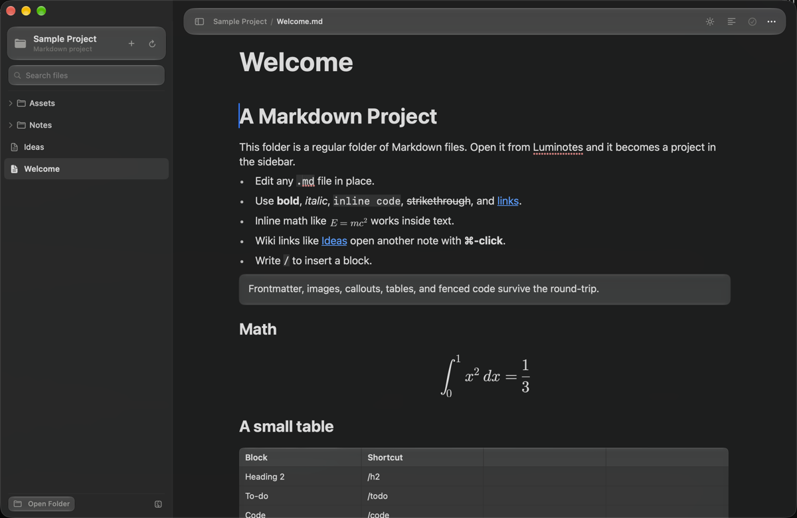

# Luminotes

A native macOS Markdown project editor inspired by Notion. Open a folder as a
project, browse every Markdown file in a sidebar, and edit the files in place
with a block-based writing surface.



## Requirements

- macOS 14 or newer at runtime
- Xcode 26 or newer to build (the project was built with Xcode 27, which
  provides the Liquid Glass SDK)

## Run

Open `Luminotes.xcodeproj` in Xcode and press **Run**, or build from the command
line:

```sh
xcodebuild -project Luminotes.xcodeproj -scheme Luminotes -configuration Debug build
```

## Releases

Tagged builds (`v*`) are published automatically to
[GitHub Releases](https://github.com/MineChampion09/luminotes/releases) as a zip
and a DMG. Release builds are unsigned, so the first launch may require
right-clicking the app and choosing **Open**. To cut a release:

```sh
git tag v1.0.0
git push origin v1.0.0
```

## Projects

- Press **⌘O** or click **Choose Folder…** to open any folder as a project.
  Opening a folder shows an empty state until you choose a note.
- Every `.md` and `.markdown` file in the folder (recursively) appears in the
  sidebar, alongside PDF and image assets. The current folder card is the first
  item; folders start collapsed and can be expanded individually. The selected
  file uses a quiet neutral row rather than a colored highlight.
- Drag a PDF or image from the sidebar into a note to embed it. Dropped files
  outside the project are copied into an `Assets` folder beside the note.
- Files are read as Markdown and written back to the same path after a short
  autosave debounce.
- Frontmatter is preserved.
- Relative image and PDF paths are resolved against the note's folder. Imported
  images are copied into an `Assets` folder beside the note.
- The note title is the file name. Editing the title renames the file on save.
- New notes are created with **⌘N** as `Untitled.md` in the project root.
- The last project and selected file are restored on launch.
- Search filters the sidebar by name or relative path.

There is a ready-to-open `Sample Project/` folder in this repository.

## Liquid Glass

The whole window is a slightly opaque, behind-window glass surface: it blurs
what is behind it without becoming hard to read. On macOS 26+, floating chrome
uses Liquid Glass:

- the slash-command menu
- table, code, PDF, Mermaid, and image-placeholder containers
- inline math popovers and math block editors
- primary buttons

The top bar is a floating rounded Liquid Glass bar tinted like the sidebar;
content scrolls beneath it. The sidebar sits on a subtle tinted
overlay above the window glass, and the editor is transparent so the same
material runs edge to edge. On older macOS versions, the glass panels fall back
to `.ultraThinMaterial` and bordered buttons.

## Blocks

- Paragraph
- Heading 1–6
- Bulleted list
- Numbered list
- To-do list with checkboxes
- Toggle list with collapsible children
- Quote
- Callout rendered as a plain glass box with text
- Divider
- Code block with a language label and copy button
- Math equation rendered from LaTeX
- Mermaid diagram rendered from a fenced `mermaid` block
- Image with a caption
- PDF embeds rendered with PDFKit, with a full editor for editable text boxes
- Editable table with fit-content / fill-width layouts and add/remove rows and columns

## Writing behavior

- Type `/` to open the searchable block menu. Use `↑`/`↓` and `Return`, or click
  a result.
- Use `/math` or type `$$ ` to insert a LaTeX math block. Equations are rendered
  natively with SwiftUIMath and saved as `$$ ... $$` in Markdown. Block equations
  update live in the note while you edit.
- Inline equations use `$...$` and update live in the text while you edit.
  **Cancel** restores the previous equation. Inline math also renders inside
  table cells.
- Mermaid diagrams use a fenced `mermaid` block. Click the diagram or its
  **Edit** button to change the source; the diagram updates live as you type.
- The toolbar has a **justify text** toggle for a LaTeX-style filled text block,
  with hyphenation to keep line breaks natural. Justified text is on by default.
- Luminotes starts in light mode. The toolbar also has a light/dark appearance
  switch. Right-click it to return to the system appearance.
- Tables fill the editor width by default. The table options menu at the top-left
  of a table switches between **Fill width** and **Fit content**, and adds or
  removes rows and columns. Cell text wraps and rows grow so the full content
  stays visible.
- Wiki links use `[[Note]]` or `[[Note|Alias]]`; ⌘-click opens the note.
- Image embeds use `![[image.png]]`; PDF embeds use `![[file.pdf]]` and are
  rendered inline with PDFKit. Use the expand button on a PDF to open the full
  editor. Text boxes are stored in a custom `<pdf>.luminotes.json` sidecar, so
  they remain editable, movable, resizable, and styleable without changing the
  PDF itself. Their font, size, text color, and background color are edited in
  a popover so the page does not shift. Use `⌘Z` / `⇧⌘Z` to undo or redo
  annotation changes, and Backspace to delete a selected text box while not
  editing its text. Saved text boxes appear over the PDF in the note.
- Notion-style Markdown shortcuts:
  - `# ` through `###### ` for headings
  - `- `, `* `, `+ ` for bullets
  - `1. ` (and `a. ` / `i. `) for numbered lists
  - `[] ` or `[ ] ` for a to-do
  - `> ` for a toggle
  - `" ` for a quote
  - `` ``` `` for code
  - `---`, `***`, or `___` for a divider
- Inline Markdown autoformatting for `**bold**`, `*italic*`, `` `code` ``,
  `~~strikethrough~~`, and `[text](url)`.
- Inline styling commands: `⌘B`, `⌘I`, `⌘U`, `⌘E` (code), and `⌘⇧X`
  (strikethrough).
- `Return` splits a block, `⇧Return` inserts a line break.
- `Tab` / `⇧Tab` nests and un-nests blocks.
- `↑`/`↓` at the edge of a block moves between blocks.
- `⌘⇧↑` / `⌘⇧↓` moves the current block.
- `⌘Enter` adds a paragraph below the current block (useful for leaving a code
  block).
- Drag the six-dot handle to reorder blocks. A blue guide shows the drop point.

## Markdown import / export

The project parser handles paragraphs, headings, bulleted and numbered lists,
task lists, quotes, GFM callouts (`> [!NOTE]`, `> [!TIP]`, `> [!INFO]`,
`> [!QUOTE]`, etc., with optional titles), fenced code, LaTeX math blocks
(`$$ ... $$`), inline math (`$...$`), tables, horizontal rules, images,
frontmatter, wiki links, and inline formatting. Toggles are written as bullet
lists because Markdown has no native toggle syntax.

Known gaps: wiki links inside table cells are preserved but are not rendered as
links there. PDF page anchors open the right page, but Obsidian rectangle
highlight anchors are not drawn yet.

Use **Export as Markdown…** (`⌘⌥E`) to write a standalone copy with a generated
`# Title` heading. When exporting a project file, referenced images are copied
beside the exported file.

## Keyboard shortcuts

- `⌘O` open a folder as a project
- `⌘N` new note (project-aware)
- `⌘⇧R` rename the current note / focus the title
- `⌘⇧M` edit inline math beside the caret
- `⌘⌃S` show or hide the sidebar
- `⌘⌥E` export a Markdown copy
- `⌘B` / `⌘I` / `⌘U` / `⌘E` inline styles
- `⌘⇧X` strikethrough
- `⌘⇧↑` / `⌘⇧↓` move block
- `⌘⌥1` / `⌘⌥2` / `⌘⌥3` headings
- `⌘⌥4` to-do
- `⌘⌥5` bulleted list
- `⌘⌥6` numbered list
- `⌘⌥7` toggle
- `⌘⌥8` code

## Architecture

- `Models` — `Note`, `Block`, `TableData`, `RichText`, `ProjectFile`, and slash
  command definitions.
- `Persistence` — Markdown parsing/serialization, project folder scanning, and
  scratch-note storage.
- `Editor` — SwiftUI root/sidebar/editor shell, block renderers, slash menu,
  drag-and-drop, and the `RichTextEditor` NSTextView wrapper.
- `Support` — adaptive palette, typography, Liquid Glass helpers, and
  behind-window glass.
- Math rendering — native `SwiftUIMath` Swift package (MIT), with LaTeX source
  stored in the Markdown file.
- Mermaid rendering — [Pele](https://pele.run) (MIT), Obsidian's open-source
  Mermaid-to-SVG renderer, bundled locally in a `WKWebView`. Third-party
  notices are in [`THIRD_PARTY_NOTICES.md`](THIRD_PARTY_NOTICES.md).

The scratch note (when no project is open) is stored at:

```
~/Library/Application Support/Luminotes/note.json
```

Project notes are not duplicated: edits go directly to the Markdown files in the
chosen folder.

## License

Luminotes is released under the [MIT License](LICENSE).
