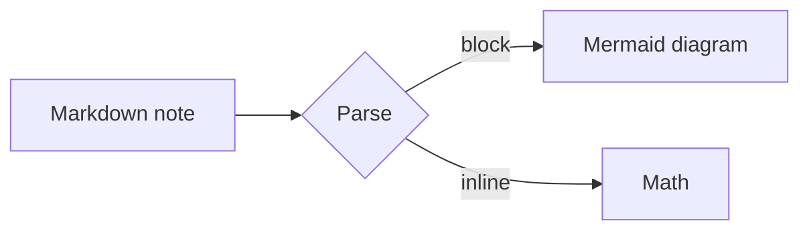
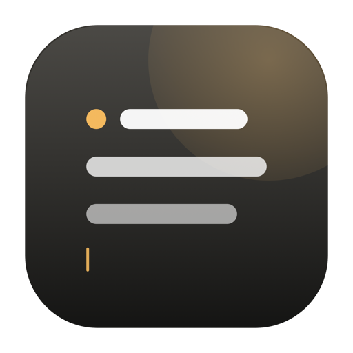

#  A Markdown Project

This folder is a regular folder of Markdown files. Open it from Luminotes and it becomes a project in the sidebar.

- Edit any `.md` file in place.
- Use **bold**, *italic*, `inline code`, ~~strikethrough~~, and [links](https://example.com).
- Inline math like $E=mc^2$ works inside text.
- Wiki links like [[Ideas]] open another note with **⌘-click**.
- Write `/` to insert a block.

> [!TIP]
> Frontmatter, images, callouts, tables, and fenced code survive the round-trip.

## Math

$$
\int_0^1 x^2\,dx = \frac{1}{3}
$$

## A small table

| Block | Shortcut |  |  |
| --- | --- | --- | --- |
| Heading 2 | /h2 |  |  |
| To-do | /todo |  |  |
| Code | /code |  |  |
|  |  |  |  |

```swift
struct Note {
    let title: String
    let blocks: [Block]
}
```

## Mermaid



---


